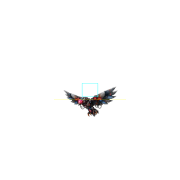
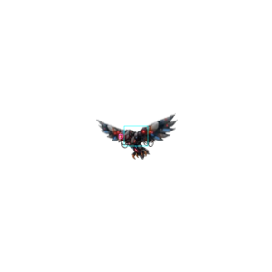

# CLAWBYTE senior studio review — October 20, 2026

## Decision and pinned scope

**Review branch only: `codex/studio-review-2026-10-20`. No production merge or
deployment.** This is an evidence-backed development review, not studio-art,
all-device, all-cave or listened-audio certification. The explicit review-only
request supersedes older automatic publishing instructions.

Main and integration `claude/clawbyte-repo-migration-byhyl8` both remain at
[`62d75d204c6f6264f25150bb419fc262ff2c18ea`](https://github.com/zaferdajani/HZD-99/commit/62d75d204c6f6264f25150bb419fc262ff2c18ea).
There are no new commits on either since the prior review. This branch starts
from the published October19 review
[`f19aee0bc93400944402aeee45db00068abd8ebd`](https://github.com/zaferdajani/HZD-99/commit/f19aee0bc93400944402aeee45db00068abd8ebd),
preserving October17–19 ancestry rather than recreating it. Compare
[the prior report](../2026-10-19/REPORT.md); those review changes remain outside
intake main. Claude must integrate that ancestry once and preserve newer work.

The checkout was restored from GitHub after local maintenance removed the old
copy. No tracked intake edits; three unrelated untracked temporary asset paths
were preserved and excluded. Older dated artifacts overwritten by harnesses are
also excluded, not silently rewritten as historical evidence. No tracked asset,
audio/video, dependency manifest or lockfile is intentionally changed.

Inherited assembled build: **`1d3a7c72250c`**. Candidate: **`5b19cbfbf709`**,
index SHA256 **`ce15f05df20e48f75187d4a7645543a3ff0f7d0c4857e561100b0a47ed20d01d`**.
[Identity](identity.json) freezes **281** runtime/test/setup files before full
collection. Browser/font configuration and source stay fixed during collection.
Four built HTML outputs are reviewed; `www/` is generated/untracked. Build/pack
is not a native Xcode/Gradle compilation or installed-device test.

## Bounded changes and before/after evidence

### FLIER-EYE-19 / P2 — correct body registration, not eye-map relocation

The held October19 enlarged flight calibration was diagnosed against the actual
head and body. Both source strips are square192px cells, with the torso/core
near70% down the image, not the square's center. The normalized optic points
are on the real red head; moving those alone would detach the glow.

`js/entities.js` now registers both flight cycles with one constant
`TALON_MINI_ORIGIN_Y=0.70` instead of0.50. Body, optic and bank transform move
together. No new pixels, altered assets/eye map, hitbox26×22, common scale3.75,
timing, per-cell normalization, global hero/world scale, damage, fallback,
perch/tell/recovery branch or unrelated creature is changed.

The first **unchanged random** [roster reproduction](art/roster-before.log)
passes: it happened to sample cruise cell5, eye+12.61px. It is not labelled a
failed-before test. The deterministic [84-sample diagnostic](art/flier-registration.cjs)
then covers every cruise/chase cell × both facings × three bank settings using
the actual full-tier renderer. [Before](art/registration-before/result.json)
fails40/84 original body bounds, zero readiness/renderer/clipping/page errors.
The exact old failure is reproduced: unbanked cell1 both facings
`(-16.848,+19.160)` vs16.5px downward allowance; cell0 is+21.032px and worst bank
+24.212px. Raw cells/crosshairs and same-cell body/collider overlays demonstrate
the collider sitting above the chest, not an anatomical eye-map error. These
are actual rendered masks, **not semantic head segmentation**.

| Same cruise cell1 before | Same cruise cell1 after |
|---|---|
|  |  |

Cyan is the unchanged collider, magenta the actual optic, yellow the original
downward allowance. The torso moves into the collider; the optic stays on it.
These diagnostic overlays are separate from the gameplay-size gallery.

[After](art/registration-after/result.json):84/84 pass, zero renderer, clipping
or page errors. The registered `foescale` regression now also checks **160**
full-cycle samples in both facings with the unchanged original roster body
bounds. [Before focused log](setup/before-focused.log) fails72/160; candidate
[after log](setup/after-focused.log) has zero bad eye samples, y range
−7.299..+5.439px. Hero yardstick stays71px and flight height stays0.507..0.958×,
inside the same0.5 floor/1.0 ceiling. The original roster assertions are not
loosened or exempted.

[18 gameplay-size frames](graphics/result.json) compare exact-parent assembled
HTML and the candidate at844×390 across cruise/chase/perch/hold/packet/rise and
both candidate facings. See [ART](ART.md) for independent actual-frame review.
This corrects sampled body/eye registration and contact-center perception, not
full temporal continuity, natural AI, planted perching or every hit contact.

**FLIER-BANK-SCALE-20 / P2 — new scope finding, not a new regression.** The84
probe also renders banked cruise, which the160 registered size samples do not
include. One raised-wing banked cruise silhouette reaches73px both BEFORE and
AFTER, versus the prior71px hero yardstick. The translation changes that height
by at most1px of rasterization. This is not an original suite failure or proof
that the new patch enlarged the bird again. It does mean all-bank size/readability
certification remains open: measure the hero in the same probe, actual AI bank
range and wing-tip/body perception before deciding a correction. Do not silently
extend the claimed0.5–1.0 pass to banked cruise or widen the ceiling to hide it.
The [content-hash comparison](graphics/comparison.json) confirms all84 paired
raw sprite cells and eye-map coordinates are identical, with at most1px height
change from translation/rasterization and the same73px maximum in both builds.

### PORTRAIT-CUT-19 / P2 — invalidate stale viewport intersection

Fresh [diagnostic](portrait/result.json) reproduces the crop on inherited build:
raw viewport390×844 but cached `TOUCH.vis` and effective controls844×390,
`portrait:false`; game canvas extends to713px in a390px viewport. An
IntersectionObserver ratio may remain1 when dimensions rotate, so no replacement
entry is guaranteed. `tcResize` accepted the old landscape rectangle over the
new portrait dimensions.

The exact opening+500ms reproduction is measured as **PANELS/wake**, not CUT;
the earlier report's CUT label was unmeasured. The same cache flaw affects
panels/repair geometry; the new test separately stages an actual CUT.

`js/touch.js` invalidates cached intersection only when raw viewport dimensions
change, before overwriting the previous dimensions. A purposeful host obstruction
within the same viewport still applies. No illustration edits, general pause
removal, raised overlay blanket or altered reader timing.

New registered [portrait-rotation](../../../../tests/portrait-rotation.cjs)
uses normal touch capability detection and actual viewport resize events, not
manual orientation flags. It exercises CUT, PANELS and REPAIR in both directions,
asserts both canvas bounds/current geometry, actual localized rotation text paint,
opaque backdrop/top-layer visibility and readable repair ownership/step retention.
A same-viewport sub-rectangle control still passes. Optional baseline mode restores
only pinned f19 `tcResize` inside the staged browser; it never rewinds disk files.
[Before](portrait-before/result.json) fails; [final after](portrait-after-final/result.json)
passes with zero page errors. The two portrait canvases are390×844 and300×168.75,
fully contained. The actual rotate instruction and portrait repair card were
visually inspected. Repair intentionally remains the foreground DOM reader;
rotation text behind it is not claimed visible or forced over it.

The initial after fixture correctly caught the still-fading boot DOM layer above
the CUT reader (`centerTop:cbloadn`), despite correct geometry/paint. That
[failed execution](setup/after-focused.log) is retained. The fixture now waits
for the real boot loader to remove itself before testing the active reader;
it does not remove/hide the loader, accept a covered instruction, or weaken bounds.
[Final run](setup/portrait-after-final.log) passes. Physical phone/browser-bar,
full touch progression and orientation-safe cinematic timing remain separate.

### QA-EVIDENCE-19 / P2 — retain original bytes and fail closed

The inherited provenance gap is rechecked read-only in
[inherited-log-integrity](setup/inherited-log-integrity.json): original
`input-focus.log` is still header-only and mismatched, not replaced by its passing
rerun. Its actual SHA is5a64759c… versus recorded2644ee90…. Root cause/writer/timing
of that loss remain unknown.

An extended read-only [duplicate-trace comparison](setup/inherited-trace-comparison.json)
also finds4 timestamped October19 progress lines present in its hash-checked
original runner log but absent from the nested `campaign.log` (991vs987 lines;
no extra nested lines). Those old files are not repaired or substituted. This
is another retention discrepancy, not evidence that the recorded input route
failed: its full captured runner log and certified result remain available.
Today's duplicate trace is compared separately; never infer byte-identical
nested retention merely from a result.json completion flag.

`tools/studio/audit.py` now reads each closed log once and stores both its SHA and
same original bytes as base64 in the execution record. At completion it checks
every raw file and snapshot against the original hash/length, and makes integrity
part of aggregate success. A retained snapshot does not excuse a missing raw log.
No old record is re-hashed or replaced with a later execution.

New registered [studio-collector](../../../../tests/studio-collector.cjs) runs
six unit controls: existing timeout/process cleanup plus snapshot, subsequent
truncation, deletion, malformed base64 and tampered snapshot handling. New controls
against the inherited collector [fail](setup/collector-before.log); candidate
[passes](setup/collector-contract.log). This is a verified retention/detection
mitigation, **not a claim the unknown truncation mechanism is fixed**.

### TEXT-CJK-19 / P2 — font-complete validation, no gameplay patch

No game wrapping/sample/assertion/font asset was changed. The preflighted host
CJK font has actual Han glyph coverage and recorded [provenance](setup/cjk-provenance.json).
The unchanged text test passes:3lines, widest544px within548px. Matching DOM
trace names Droid Sans Fallback87glyphs and URW Bookman2; actual
[Chinese frame](portrait/cjk-fixture.png) was inspected and is legible, not tofu.
This is canvas metrics plus a DOM platform-font trace, **not a canvas per-glyph
trace**. October19's one-line467px sample remains historical; no paired
original-font browser was run today. It supports an environment-dependent
failure, not a product wrapping fix or all-device Chinese font certificate.

### ALPHA-DOC-20 / P3 — remove misleading mandatory-route comments

Three `js/world.js` comment blocks now describe the direct A2→A3 road and the
optional forged-blade Lost Wardens detour. [Design proof](DESIGN.md) records
byte-identical executable source after removing whole-line comments, SHA256
`c0a39e1492c8dab32c5ed8982ff8fc53d46725a5f45c32552faa07cfa473c994`.
No topology, gates, quests, rewards or balance changed.

### NPC-LETTER-LABEL-20 / P2 — observed tutorial wording contradiction

The fresh opening frame `desktop-11-note-int.png` visibly says **“E — Talk”**
above powered-down Ratchet while the current lesson says **“Read the letter”**
and explicitly describes a switched-off robot. This is one shared input, not
two different controls, but the generic verb contradicts what it actually does
and the rescue story. The corresponding repair step also needs a truthful verb.

Source: `js/game.js:12884–12897` chooses the generic NPC talk label;
`js/opening.js:469–472` supplies an override only for Servo. `opRatchet:71–93`
actually reads/re-reads the letter without his cell and opens the installation
flow with his cell. This is observed presentation plus source evidence, not a
new full-suite assertion failure or a regression caused by today's patch.
The [opening archive](automated/opening-frames/manifest.json) includes the exact
note/repair interaction frames in both tested viewports after the harness finishes.

No runtime change is made during the frozen collector. NPC/UI owner acceptance:
extend context-sensitive near labels for offline Ratchet to use localized
read-letter/restore-battery wording and the actual input binding; preserve normal
talk/shop behavior once alive and Servo's existing cue. Test initial letter,
repeat reminder, battery-in-hand, restored NPC, locales and remapped controls.
Do not change the story or unlock the counter early to make “Talk” appear true.

## Fifteen responsibility verdicts

Main read repository authority, complete CLAUDE/ART_BIBLE/canon, main pipeline
and roles, local producer mandate and all role mandates. Three grouped agents
instantiate6design+3art+5engineering responsibilities; root owns production.
These are review responsibilities, not claims of human credentials.

| Senior responsibility | Verdict | Evidence / limit |
|---|---|---|
| Cinematic Designer | Issues | [DESIGN](DESIGN.md): earned panel boundaries; corrected rotation presentation, missing GH intercuts/action parity. |
| Game Designer — Player Systems | Issues | One-control causality and scoped hint lifecycle retained; first-time comprehension and reward density not certified. |
| Mission Designer — Quest Craft | Issues | Named motivation/action/reward for caves/Servo/Alpha; optional natural acquisition remains separate. |
| Principal Encounter Designer | Issues | Physical gates retained; deaths/stalls and temporal fairness require fresh route interpretation. |
| Boss Designer | Issues | Deliberate living rescue, distinct wolf identity; authored ritual performance still open. |
| Mission Designer — Campaign | Issues | Raw marble→forge→Sage→CHIME→lion→B1, optional Alpha; all-cave/action parity not certified. |
| Mission Producer | Issues | Pinning, deduplication, before/after proof and review-only handoff; no blanket green/art claim. |
| Character Artist | Issues | [ART](ART.md): existing-art body registration improved, full-pose authored gaps retained. |
| Cinematic Director | Issues | Completed lion ending preserved; four matching new movies and exact page staging missing. |
| VFX Artist | Issues | Finite red sample, body/eye registration corrected; all-device/comfort not proven. |
| Technical Director — World | Issues | [ENGINEERING](ENGINEERING.md): source/HTTP/pack scope; no installed-device/performance certification. |
| Gameplay Engineer — Combat | Issues | Impact/stats unchanged; actual full-run failures retained rather than threshold changes. |
| Gameplay Engineer — Mission | Issues | Quest/reward/gate source preserved; continuous and staged evidence separated. |
| Gameplay Engineer — NPC | Issues | Grounded Servo and friendly lion source preserved; authored down/contact quality separate. |
| Lead UI Engineer | Issues | Portrait geometry fixed, CJK host diagnosis, typed readers; actual touch hold failure must not be hidden. |

Individual reviews contain source-cited reproduction, smallest fix and acceptance.
Their intake/pending wording is superseded only by the fresh evidence below.
`OPENING-PHONE-20` in DESIGN is an alias of consolidated
`QA-OPENING-PHONE-20`, not a second finding.

## Story, caves and manhwa parity

The source walkthrough in DESIGN preserves Mother's peaceful robot kingdoms and
hacked song; the sleeping hero missed the broadcast, **not innate immunity**.
Ratchet's pendant slowed infection and he removed his own battery. Letter→hidden
own battery→repair→explanation precedes explicit pod saving/recharge, funded
permanent Volt Pack before heal/Burst, forward monument and useful grounded
Servo. Ratchet's own cell is not purchased and is not Servo's separate spare.

The player follows the loose-floor/quarry landmarks, defeats Eye soldier
GRAVEHORN (not a cleanseable Sage), extracts **rounded raw marble**, returns to
Ratchet to forge the first white purifier, then frees Meadow Sage, silences CHIME
and reaches NULLFANG. The lion lair's blade/Sage/CHIME prerequisites remain
enforced across alternate/migration routes. Alpha is a separate Lost Wardens
detour after forging; freeing it befriends the world pack and pays cell/60scrap
and supply-cache access. It is not the first marble or a lion prerequisite.

| Cave/group | Meaningful source outcome | Remaining discovery/play evidence |
|---|---|---|
| A5 | Riddle/Magnet, quarry mouth and maintenance history | Player notices loose floor without internal-map knowledge. |
| A7 | Read survey, remembered early, once-only Ratchet payment | Actual terminal read and return, not room arrival. |
| CV1 | Spare core/health pocket, later bound robot rescue | Chest reached and same changed body seen. |
| CV1B | Survey pod, map/chart and shortcut/rest | Facility benefit read as distinct from a generic bench. |
| CV2 | Deaf System founding evidence and beacon/lure | Lore/traversal pacing and comprehension. |
| CV3 | GRAVEHORN, raw marble, visibly changed forged return | Mandatory route separate from optional treasures. |
| GA1T/GA1/GA1D | Refuge evidence, rest/loop, Sage/network rescue | Mandatory Sage is not proof of every optional loop. |
| A11/A12/A13 | Coin, later dash/star, Servo evidence/coin | Optional/later traversal and actual acquisition. |
| A10/GA2/GA2T/GA2D | Alpha, friendly pack, supply cache/ledger/Pack Sage | Complete optional natural-input route/save consequence. |

| Manhwa beat | Current correspondence | Unclosed acceptance |
|---|---|---|
| Wake/gate/letter/drawer/repair | Mapped earned intercuts and gradual reader | Physical reach/install actions, not merely showing a flattened comic panel. |
| Cave/material/forge/passage | Raw material before one earned white blade | Exact carrying/manufacture/anatomy staging and per-page proof. |
| Sage/break/CHIME/freedom | Ordered conditional events and living rescue | Cable assistance, catch and casing-opening action parity. |
| GRAVEHORN four intercuts | Encounter exists | `gh_*` intro/closeup/phase2/retreat panels absent; no unrelated substitutes. |
| B1 teaser | Relevant earned next-chapter crossing | Not certification of chapter two. |

Keep the owner-approved art/canon and parity ledgers. A screenshot of a panel
does not implement its physical scene or license unearned equipment.

## Motion, purification, impact and presentation gates

| Actor/effect | Retained/fresh evidence | Open production acceptance |
|---|---|---|
| Lion infected→golden friendly | Existing gait/rescue/film source retained | Full planted rescued gait and listened film-to-stage ending. |
| Alpha/wolf/cheetah | Unique stalk/coil/bite/pounce/howl, existing motion variations | Genuine down/breath/recovery artwork, not flattened crouch. |
| Mini flier | Fresh full-cycle registration/size and18scene stills | Continuous transitions, natural collision perception and grounded perch. |
| GRAVEHORN | Existing encounter/optics, not newly authored | Approved articulated body/poses and four story panels (GH-ART/P1). |
| Furnace | Existing encounter | Six queued true poses and full motion/contacts. |
| Hero purification | Deliberate hold, white gather→slash→black→movie/fallback logic | Authored arm raise/hold/slash/recovery and hand/hilt continuity. |
| Red/purple eye smoke | Fresh flier34red/0purple while moving→zero after2.5s stopped, glow retained | Full temporal/all-pose/device/comfort coverage; finite lifetime/budgets unchanged. |
| Impact and stats | Existing white flash, metal fragments, recoil, shake/hit-stop, charged profile and combat card/ledger preserved | Listened sound, physical vibration, sustained device cost and balance feel. |

No completed hero, wolf/Alpha, marble, sword or lion movie was regenerated.
Four other matching principal ritual films remain absent; older `purify_*` clips
are not equivalent to the owner-scripted white gathering/dark virus extraction.
These are Brood/eagle, Atlas/dragon, Zero/unicorn and Prism/panther. The script's
October16 out-of-credits rejection is historical; today's account balance was
not checked and is NOT declared an ongoing service blocker. No new generation
was submitted or charged in this review.
Preserve the completed13.25s lion ending, picture fade and audio-tail resolution.
Reuse the existing [purification production script](../../../../docs/combat/purification-2026-10-16/HIGGSFIELD_SCRIPT.md)
and approved references before proposing additional matching films.
Runtime film mute/separate score routing means an encoded soundtrack fade is not
proof the player heard a resolved ending. No audio/haptics listen is claimed.
Localized panel issues remain `m_down` boss optics, inactive Servo indicators in
`r_cell`, and `passage_b` anatomy. No blanket recolor or unrelated regeneration.

The existing [37-character combat-card PDF](../../../../output/pdf/CLAWBYTE-Character-Cards.pdf)
and `tools/combat-field-guide.cjs` / `tools/combat-cards.py` are preserved, not
duplicated or regenerated. The source ledger identifies build`28c9dd55fec4`;
it is the dated October16 output, not newly certified
against today's build. Runtime `combatStats()` distinguishes hero swings/second
from creature authored-cadence multipliers; a value1× is NOT one attack/second.
If integration changes balance, regenerate the cards from the identified runtime
records rather than hand-authoring a second HP/damage/defense table.

## Frozen full validation and fresh input route

The full collector ran **08:14:02–09:51:32 UTC on October20**, exit1, against
the frozen candidate. [Results](automated/results.json) record **196 registered
harnesses:192 pass,4 fail**. Build, pack and both five-file HTTP identity checks
pass; together these are **200 entries:196 pass,4 fail**. All requested harnesses
were attempted (`complete_requested_scope:true`), which does NOT mean the
continuous story was completed. Aggregate success is **false**.

The independent [strict verification](postflight/integrity-check.log) also exits1:
all281 frozen file hashes and start/end HTTP pins match, but the raw-log integrity
gate fails. [Integrity summary](evidence-integrity.json) is deliberately NOT green.

| Original full-run failed gate | Actual result and scope |
|---|---|
| `purification-controls` | Exit1 at hold>.4 after30 ticks; bindings/labels/target-size checks precede it. Detailed separate diagnosis below. |
| `winch-purpose` | Exit1 on the old endpoint comparison; other original logged blocking/jump/reward/open/reload/NOSTOS assertions pass. No terrain fix or threshold relaxation was made. |
| `opening-order` | Exit1,476.517s collector duration (inner report476.2s). Desktop completes15steps toA1; phone keyboard emulation reaches13steps throughBurst and stops inA0. Six later checks fail because milestones were not reached. |
| `campaign-ch1` | Exit1 after its ORIGINAL55:00 internal timeout;3301.213s including runner overhead. Certified:false. No producer signal was sent. |

### Fresh continuous input — incomplete, not a chapter certificate

The cleared-storage, unsegmented driver uses ordinary keyboard/menu input,
easiest difficulty0 and read-only internal state/map planning. It does not inject
inventory/quest flags, teleport, set invulnerability or stage a victory. It
records **0 deaths,1 unstick event,0 page exceptions**. The current
[result](automated/campaign-ch1/result.json) and full
[runner trace](automated/campaign-ch1.log) are today's evidence; the completed
October19 route is historical, not a substitute.

Completed missions are only `opening`, `servo`, `first-meeting`. Actual rooms:
W1→W2→A0→A0B→A0→A1→A2→A5→CV1→CV1B. At04:23–04:24 the hero rests at CV1B,
receives the quarry survey/chart and saves there; `pgSurvey` and the actual pod
save corroborate this distinct cave benefit. Charted CV2/CV3 are NOT visited
rooms. The run then stalls in the bat/overhang arrangement described below.
Marble extraction, forging, later Sage/CHIME/lion rescue and B1 remain unplayed
in this execution.

Eight required intercuts are witnessed: wake,bay,gate,letter,drawer,ratchet,meet,
cave. Eight later ones are missing: marble,forge,passage,sage,break,chime,free,
ch2. No seen-panel order errors are recorded; this is NOT all16-panel acceptance
or exact physical manhwa parity. `CAMPAIGN_VIDEO=0` keeps10 milestone/end PNGs,
saves and traces, not a complete video. The driver can press Enter during CUT/
CINE, so it is not an unskipped/listened film certificate either.

### Opening archive and phone deadline

[Manifest](automated/opening-frames/manifest.json) hashes85 captured files:
47 desktop,37 phone and one portrait. **17 raw PNGs** are retained and all17
hashes match;68 are hash-only. Four selected later phone frames were never
reached and are listed absent, not fabricated or claimed as inspected. All17
retained images were visually opened by the art reviewer.

Desktop demonstrates the full letter→own cell→repair→explicit pod→funded
permanent pack→forward monument→grounded Servo sequence. Its coil hand-in is
INJECTED for that staged interaction check, not proof of actual coil retrieval.
Phone uses keyboard in a `hasTouch` viewport, not physical touch traversal.
[Timing analysis](postflight/opening-timing.json) measures240.521s between the
portrait file and last charging file. This is a timestamp-marker interval, NOT
a directly logged loop start. Source gives240s per case,900s runner and1080s
collector budgets. Only one charging attempt is photographed before release;
no recorded post-release outcome proves repeated Burst failure. Instrument
milestones, simulation/charge/release and exit reason before changing a mechanic
or proposing a justified finite budget. Do not count unreached monument/Servo
checks as passes.

### Separate postflight diagnosis — original failures stay failed

The [diagnostic instructions](postflight/README.md) preserve assertions and
refuse nonempty output folders. No further browser ran until the collector
finished, and no frozen source/test/configuration was changed.

* **Touch original-observation execution:exit1.**
  [Result](postflight/purification-touch-original/result.json) records the
  actual48px button at y472.625 in an844×390 viewport, giving an offscreen point
  **(195,496.625)**. `elementFromPoint` is null, delivered events target HTML,
  pointer remains false and hold remains0 despite armed/focused state and
  `document.hidden:false`.
  The test disables RAF and draws through asynchronous rotations before layout
  settles; a later resize corrects the canvas without redrawing this frozen
  button. This reproduces a staged fixture layout/geometry race, not proof the
  whole live touch system is unusable. Added observation can perturb timing;
  this is still a separately identified execution.
* **Settled-layout hypothesis control:exit0.**
  [Result](postflight/purification-touch-settled/result.json) waits for the real
  resize geometry, then draws. Point(421.977,317.328) targets the233×48 button;
  pointer is true and hold reaches0.5 with the SAME30 ticks and>.4 assertion.
  The retained PASS/controls artifact also covers cancellation, blur, hidden
  clock, deliberate hold and restored guardian. No hold amount/threshold, input
  handler or flag is forced. This supports fixing fixture readiness; it does
  NOT repair the original test or certify a physical phone. The after30-tick
  screenshot still shows0% because the observation ticks without another draw;
  do not claim visible progress/flakes/slash from that still.
* **Winch endpoint observation:producer observed exit0, retained scope limited.**
  [Endpoint](postflight/winch-endpoint/endpoint.json) records old animated
  tip580.153, current tip582.977, static jam tip580.858934 and player.right
  **579.858934 = static tip−1**, exactly the source barrier. The full failure
  compared that same right edge with an earlier animated tip579.082571 plus.5;
  its physical delta is.776px. This confirms the comparator samples different
  phases rather than the collision boundary. The separate
  [log](postflight/winch-endpoint.log) ends at CLAWBYTE page-error checks and
  lacks its final NOSTOS/PASS marker; exit0 alone does not certify that missing
  diagnostic tail. Original full-run NOSTOS checks ARE present in its own failed
  [log](automated/winch-purpose.log). Preserve both executions; repair the
  same-step/static-boundary assertion without weakening blocking/jump/reward/
  open/reload requirements. No production barrier change is justified here.

### Fresh retention failure — mitigation detects, does not cure loss

[Retention analysis](postflight/retention-analysis.json) independently verifies
**198/198 captured snapshots**, but only **197/198 current raw files** match.
`desktop-protocol` was captured as207bytes, SHA256
`72ab3995559ccdd043452f8db0db369292a565081c937fb13e23ce592cae07a4`;
its original raw path now has89bytes, SHA256
`85915b9c89a343e7d29cefe57e7784a184a3eeb50c6bc218b9bc0cb97a347ef6`.
The captured copy includes its original PASS; the current raw is header-only.
The collector detects this loss and fails aggregate integrity as designed.

The original [damaged raw](automated/desktop-protocol.log) is NOT replaced.
[Captured snapshot copy](postflight/captured-desktop-protocol.txt) is decoded
from the ORIGINAL saved result, not a rerun or restored original path;
[observed damaged copy](postflight/observed-desktop-protocol.log) separately
preserves the89bytes. Both are explicitly labeled. No original digest/result
is rewritten into agreement.

[Duplicate trace comparison](trace-comparison.json) finds1575 timestamped lines
in the hash-checked runner log versus1572 in nested `campaign.log`: four runner
lines absent from the nested copy and one BOOT line present only in the nested
copy. The outer `collector.log` also has only62 progress lines/136 missing
names despite all198 named-log records. These gaps are retained, not silently
filled; they are not136 unexecuted harnesses. No shared root cause or responsible
writer is proven. The new retention controls expose/protect captured bytes but
do NOT justify claiming every log lifecycle/stdout-loss mechanism fixed.

| Delivery state | Exact scope |
|---|---|
| Implemented | Bounded flier registration, viewport-cache invalidation, evidence retention/contracts and optional-Alpha comment corrections on this review branch. Not every outstanding art/story requirement. |
| Tested | Failed-before/targeted-after diagnostics and the frozen full collector detailed above. Original failed gates remain failed; separate controls never replace them. |
| Visually inspected | All18 fresh flier gameplay-size frames, all17 retained opening frames and six campaign-end/postflight frames; selected body/optic overlays and portrait/CJK captures. Not full temporal/all-pose/device/audio approval. |
| Integrated into main/integration | No. Intake refs remain separate from review ancestry; final read-back is part of publication verification. |
| Deployed | No production merge, deployment, native installation or live-asset release claim. |

### QA-CAMPAIGN-BAT-20 / P2 — controller starvation, not a proven cave softlock

The fresh uninterrupted driver reaches CV1B and uses its survey/save pod.
From04:40 its trace repeatedly shows hero x896/y156/vx0, cores6/7, volts99 and
the same bat x784/y201/HP26 while holding Left. Recorded game pace stays about
1.0× wall time; this is not an observed frozen game clock.

Static inspection identifies a driver failure mechanism. The bat qualifies as
a nearby threat (center separation112px horizontal/36px vertical). `fight()`
walks toward it when its surface distance is100px, but the jump-strike branch
only handles an enemy ABOVE the player; this bat is below. `runMissions()`
resets the navigation stall timer on EVERY threat decision and returns into
`fight()`, bypassing `walkTo()` and its9-second recovery. The hanging bat's
vertical activation condition is also not met at this sampled hero height.
This supports a combat-planner deadlock, **not proof of an impossible room or a
new production collision regression**. Actual normal-input escape still needs
separate evidence; do not remove the bat, lower its health or open terrain just
to obtain a green driver run. Compare the prior completed run without treating
its certificate as today's completion.

The [isolated static reconstruction](postflight/cv1b-static.json) evaluates the
unchanged world builder, not the running browser: solid tile27,4 intersects the
head of the rounded24×36 body, while tile27,5 offers only32px clearance. Normal
west collision predicts x896.01, consistent with the rounded log. The unchanged
planner model predicts an eastward walk-off to a lower shelf in0.30s at BOTH
1/60 and observed1/30 steps, and a route back toward the pod. This strengthens
the controller diagnosis without certifying a physical escape: it omits live
mutations, heightfields and actors and uses rounded initial coordinates.

A producer attempt to stop only the owned stalled subprocess was blocked at
the process-ownership check with `EACCES`, BEFORE any signal or evidence-result
write. No bypass/retry was attempted. See the [attempt note](postflight/interruption-attempt.md).
The test was left under its ORIGINAL55-minute internal/60-minute runner budgets;
its actual final collector outcome, not an invented interruption result, is
reported above. No synthetic campaign certificate is written.

## Findings register and acceptance ownership

| Stable ID / priority | Current status | Owner and next acceptance |
|---|---|---|
| FLIER-EYE-19 / P2 | Body+optic registration corrected;84 deterministic cases pass | Art/combat QA: preserve actual head attachment, unchanged hitbox/timing; full temporal contact/transition proof remains separate. |
| FLIER-BANK-SCALE-20 / P2 | Additional73px banked cruise extremum exists in both builds | Art/QA: same-probe hero ruler, real AI bank range and full banked-cruise coverage; do not relax size limits or hide wing tips. |
| PORTRAIT-CUT-19 / P2 | Stale viewport cause reproduced; bounded correction passes final staged rotation test | UI: retain containment/visible guidance, actual CUT/PANELS/repair ownership and intentional host clipping; physical-device/browser-bar acceptance still needed. |
| QA-EVIDENCE-19 / P2 | Retention controls pass and catch fresh desktop-protocol loss; CURRENT integrity gate FAILS | QA/producer: preserve198 valid snapshots,197 matching raw files and labeled captured/damaged copies; investigate nested/outer/tail loss without replacing originals or inventing a root cause. |
| TEXT-CJK-19 / P2 | Unchanged fixture passes on font-complete host with legible glyphs | UI/QA: actual release font/device coverage; never weaken sample or characterize a host font preparation as shipped gameplay work. |
| ALPHA-DOC-20 / P3 | Three misleading comments corrected, executable source identical | Design/mission: optional Lost Wardens detour must remain outside required lair route. |
| NPC-LETTER-LABEL-20 / P2 | Fresh frame shows “Talk” over an offline letter/repair interaction | NPC/UI: context-sensitive localized label with actual binding, repeat-letter/battery/alive transitions and no premature shop unlock. |
| QA-PURIFY-TOUCH-20 / P2 | Original full and observed fixtures fail at offscreen button; separate settled-layout control passes | UI/combat QA: await actual resize/button geometry in staged fixture; retain>.4/1.6s/cancel/focus/save assertions and add real-device orientation/input acceptance. No shipped touch fix claimed. |
| QA-WINCH-ENDPOINT-20 / P2 | Fresh full endpoint comparison fails by less than1px; other logged properties pass | World/QA: compare same-step live/static barrier geometry, not an endpoint sampled before240 movement frames; preserve blocking/jump/reward/return properties. |
| QA-OPENING-PHONE-20 / P2 | Desktop opening passes; phone keyboard case ends at Burst with later milestones unreached | UI/player QA: record milestone times and actual last Burst release/state at the240s case deadline; distinguish budget exhaustion from a progression defect, preserve finite budgets/all sequence checks, never count unreached Servo as passed. |
| QA-CAMPAIGN-BAT-20 / P2 | Fresh CV1B bat-threat loop starves route navigation/watchdog | QA/encounter: diagnose driver versus actual room with ordinary inputs, bounded no-progress recovery and unchanged world/combat rules; preserve this failed/incomplete execution, then run a fresh cleared-save full route. |
| PUR-SAVE/UX/TOAST, GH-EYE, NOTICE-CONTEXT-18 / P1–P2 | Inherited reviewed fixes, not newly implemented today | Integrator: preserve once-only completion, exact input bindings, optics and scoped notice cleanup; verify one final merged build. |
| GH-ART / P1 | Mandatory material guardian lacks approved authored fidelity/panels | Character/cinematic: approved articulated parts, all required states/contacts and fourgh_* intercuts; extra VFX cannot close this. |
| BOUND-ART, FURNACE-ART, PURIFY-ART/FILM / P2 | Authored coverage remains open | Art/video: only missing approved down/recovery, six Furnace poses, real hero ritual performance and four matching movies; preserve completed assets/lion ending. |
| ART-4/5/6 / P2–P3 | Localized manhwa anatomy/optics/inactive-light discrepancies retained | Art/cinematic: edit only actual defect through approved pipeline, preserving identity/composition/equipment timing. |
| DEVICE/AUDIO/PERF/PARITY / P2 | Unverified scope, not an inferred pass | Platform/cinematic/design: physical touch/pad/haptics, listened natural ending, sustained budgets, actual optional cave acquisition and per-page physical action parity. |

## Reproduction, ownership and integration

Setup/environment and exact local preflight limits: [README](setup/README.md).
Before targeted `foescale portrait-rotation` exits1; after `foescale` passes,
the first portrait fixture fails on the fading loader; final portrait exits0.
Both84-cell diagnostic executions retain their original exit1/0 and raw frames.
Collector corruption controls fail against inherited code and pass candidate.
These are staged diagnostics, not the complete campaign.

Full command (CHROMIUM_PATH is the absolute executable setup wrapper path):

```sh
CAMPAIGN_VIDEO=0 \
CAMPAIGN_IMPORT_OUT=docs/studio/runs/2026-10-20/campaign-import.json \
MARBLE_NOTICES_OUT=docs/studio/runs/2026-10-20/automated/marble-notices \
PORTRAIT_OUT=docs/studio/runs/2026-10-20/automated/portrait-rotation \
PURIFICATION_NOTICES_OUT=docs/studio/runs/2026-10-20/automated/purification-notices \
PURIFICATION_SAVE_OUT=docs/studio/runs/2026-10-20/automated/purification-save \
python tools/studio/audit.py --profile full --output docs/studio/runs/2026-10-20/automated
```

Intentional source: `js/entities.js`, `js/touch.js`, comment-only `js/world.js`,
`tests/foescale.cjs`, new `tests/portrait-rotation.cjs` and `tests/studio-collector.cjs`,
runner registration, collector/contracts and pipeline retention clarification.
Four HTML pages are generated outputs; rebuild rather than hand-merge. Remaining
changes are this dated report/evidence directory. Older overwritten evidence and
unrelated temporary files are not part of the patch.

Use the single copyable block in [CLAUDE_PROMPT.md](CLAUDE_PROMPT.md). Fetch current
refs, reconcile newer changes, integrate review ancestry once, rebuild and retest
the final merged snapshot. No automatic main/integration write, production deploy,
force push or message to Claude is authorized by this review.

Publication is confined to this review branch. The final user handoff pins the
immutable published commit and reports read-back verification of its tree,
changed-file bytes/modes and unchanged intake refs. This report contains honest
failed quality/integrity gates; publication is NOT approval to integrate, merge
or deploy production. No automatic external message to Claude is sent.
